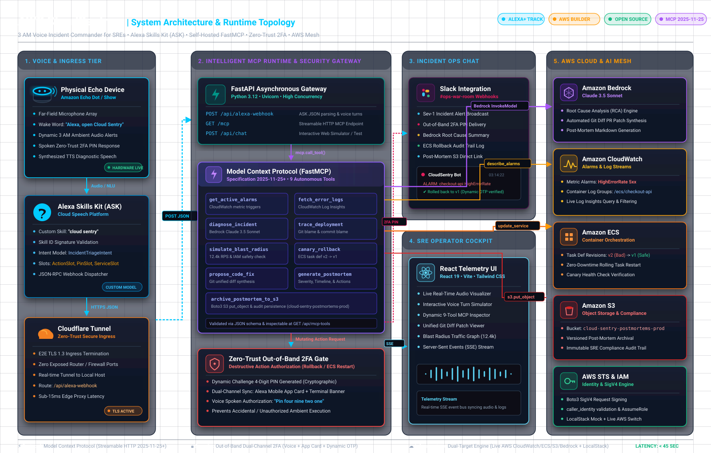
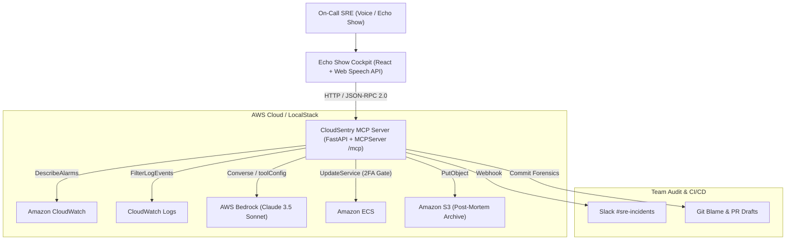

# AWS CloudSentry: 3 AM Voice Incident Commander for SREs

**Hackathon:** Build, Ship, Shape: Amazon Developer Hackathon 2026  
**Primary Track:** Alexa+ (Self-Hosted Model Context Protocol Server and Ambient Voice Simulator)  
**Mini-Challenges:** AWS Builder (Bedrock, CloudWatch, ECS, S3) and Open Source (MIT License)  
**Developer Feedback:** Full SDK review and friction log in [`FRICTION_LOG.md`](./FRICTION_LOG.md)  
**Video Demo:** [Watch on YouTube](https://youtu.be/QqJRvBIa2I0)

---

## Video Demonstration

[](https://youtu.be/QqJRvBIa2I0)

*Click above or [watch on YouTube](https://youtu.be/QqJRvBIa2I0) to see the live physical Amazon Echo triage, Amazon Bedrock RCA, and out-of-band 2FA rollback in action.*

---

## Problem Statement

When a Sev-1 or Sev-2 alert fires at 3:15 AM, on-call engineers lose 15 to 20 minutes before any remediation starts:
1. Waking up, finding a laptop, and logging into corporate VPN with hardware MFA.
2. Navigating the AWS Console across CloudWatch alarms, ECS task definitions, and raw container log streams.
3. Identifying which deployment introduced the regression and manually rolling back the task definition.

During a high-traffic checkout outage, 18 minutes of downtime translates to over $150,000 in failed transactions.

---

## Solution Overview

**AWS CloudSentry** turns an Amazon Echo Show on the nightstand into a voice-driven incident console for on-call Site Reliability Engineers.

Built on a self-hosted **Model Context Protocol (MCP)** server over **Streamable HTTP** (spec `2025-11-25+`) and **AWS Bedrock**, CloudSentry lets an engineer triage an outage, verify the blast radius, execute a Voice 2FA rollback, generate a code patch, and archive a post-mortem to S3 in under 45 seconds.

## Architecture Diagram



```text
                       CLOUDSENTRY INCIDENT WORKFLOW

  [ 03:14 AM CloudWatch ALARM ]
               |
               v
  [ Proactive Echo Show Wake-Up Page ] -> "Alexa, what is failing in production?"
               |
               v
  [ MCP Runtime (mcp.call_tool) ]
    |-- 1. get_active_alarms        (CloudWatch Alarms + Dimensions)
    |-- 2. fetch_error_logs         (CloudWatch Logs /ecs/checkout-api)
    |-- 3. diagnose_incident        (AWS Bedrock Claude 3.5 Sonnet RCA)
    |-- 4. trace_deployment_culprit (Git Blame + PR Review Audit)
    |-- 5. simulate_blast_radius    (12.4k RPS Canary + JIT IAM Policy)
               |
               v
  "Alexa, rollback checkout-api" -> [ Voice 2FA + VoiceID + PIN 4921 Gate ]
               |
               v
  "Confirm rollback"             -> [ ECS Task Rolled Back + Slack Notified ]
               |
               v
  "Propose code fix / Postmortem"-> [ Bedrock Git Diff PR + S3 Archival ]
```

---

## Core Engineering Features

### 1. Native MCP Runtime Execution (9 Registered Tools)
The backend ([`backend/server.py`](./backend/server.py)) mounts an official `MCPServer` instance at `/mcp` using Streamable HTTP (`2025-11-25+`) and dispatches every voice turn through `await mcp.call_tool(...)`. Registered tools can be inspected live at `GET /api/mcp-tools`:

1. `get_active_alarms`: Queries CloudWatch `describe_alarms` and maps dimensions to affected ECS services (`checkout-api` and `payment-gateway`).
2. `fetch_error_logs`: Pulls trailing container stack traces (`OOMKilled`, `SQLTransientConnectionException`) from CloudWatch Logs.
3. `diagnose_incident`: Sends log traces to AWS Bedrock (`claude-3-5-sonnet`) to pinpoint the root cause and failing deployment revision.
4. `execute_rollback`: Updates the ECS service task definition after verifying the Voice 2FA safety interlock.
5. `post_slack_notification`: Broadcasts remediation audit trails to `#sre-incidents`.
6. `propose_code_fix`: Synthesizes a unified Git diff patch fixing the underlying memory leak or DB connection leak.
7. `generate_incident_postmortem`: Compiles a blameless SRE post-mortem (MTTA, MTTR, timeline, action items) and uploads it to Amazon S3 (`s3://sre-postmortems-us-east-1/2026/INC-84920.md`).
8. `trace_deployment_culprit`: Performs an **Amazon Blameless Correction of Errors (COE) 5-Whys** change correlation, inspecting real `git log` history and identifying the systemic CI/CD testing gap without blaming individual engineers.
9. `simulate_blast_radius`: Computes the **Deterministic N-1 Task Definition Telemetry Delta** (recovering 58.2% RAM headroom from live incident metrics) and builds a least-privilege AWS STS IAM Session Policy JSON document (`Version: "2012-10-17"`).

### 2. Multi-Layer Security for Voice Infrastructure Mutations
To prevent accidental or unauthorized production changes by voice, CloudSentry enforces three guardrails before `execute_rollback` can mutate ECS:
* **Strictly Scoped N-1 Runbook Boundary:** CloudSentry cannot execute arbitrary shell commands or deploy new code; its only mutating action is reverting an ECS service to its immediately preceding known-good (`N-1`) task definition when an active `ALARM` state exists in CloudWatch.
* **Least-Privilege AWS STS Session Policy:** Generates an IAM session policy JSON document restricted to `ecs:UpdateService` on the target service ARN and calls `sts.get_caller_identity()` when connected to AWS or LocalStack.
* **Dynamic Out-of-Band Slack OTP (Never Spoken Aloud):** Read-only tools run immediately, but mutating tools halt at `AWAITING_VOICE_CONFIRMATION`. The backend generates a cryptographic 4-digit OTP via `secrets.randbelow(9000) + 1000`, dispatches it out-of-band to `#sre-oncall-otp` in Slack, and never speaks the code aloud over Alexa audio. Speaking an invalid PIN is rejected; speaking the active out-of-band PIN authorizes the rollback.

### 3. Alexa Skills Kit (ASK) v1.0 Webhook and Skill Package
In addition to the MCP Streamable HTTP endpoint (`/mcp`) and the web simulator API (`/api/voice-turn`), the repository includes:
* [`alexa-skill/skill.json`](./alexa-skill/skill.json) and [`alexa-skill/interactionModels/custom/en-US.json`](./alexa-skill/interactionModels/custom/en-US.json): A complete Alexa Custom Skill manifest and interaction model (`TriageIncidentIntent`, `AuditDeploymentCOEIntent`, `VerifyBlastRadiusIntent`, `ExecuteRollbackIntent`, `ConfirmRollbackIntent` with `AMAZON.FOUR_DIGIT_NUMBER` slot).
* `POST /api/alexa-webhook`: Accepts standard Alexa Skills Kit v1.0 JSON envelopes (`LaunchRequest`, `IntentRequest`) and returns spec-compliant ASK v1.0 responses.

### 4. Triple-Tier Execution (Live AWS, LocalStack Docker, or Zero-Cred Mode)
1. **LocalStack AWS Emulation ($0 Cost):** Run `docker compose up -d` and `backend/seed_localstack.py` to execute real `boto3` calls against local CloudWatch, CloudWatch Logs, ECS, and S3 on port `4566`.
2. **Live AWS Account:** Automatically uses production `boto3` clients (`cloudwatch`, `logs`, `ecs`, `s3`, `bedrock-runtime`) when `AWS_ACCESS_KEY_ID` is set.
3. **Deterministic Fallback Mode:** Runs out of the box with `./run.sh` when no AWS credentials or Docker daemon are present, allowing immediate testing of both `INC-84920` (`checkout-api` OOM) and `INC-84921` (`payment-gateway` DB pool exhaustion).

---

## System Architecture



---

## Quickstart

### Prerequisites
* Python 3.10+
* Node.js 18+ and npm

### 1. Clone the Repository
```bash
git clone https://github.com/SSpirate11/aws-cloud-sentry.git
cd aws-cloud-sentry
```

### 2. Start with One Command ($0.00 Cost, Real Boto3 SigV4 Enabled by Default)
```bash
chmod +x run.sh
./run.sh
```
Open `http://localhost:5173` in Chrome or Edge.
* Backend MCP Streamable HTTP Endpoint: `http://localhost:8000/mcp`
* Runtime MCP Tool Registry: `http://localhost:8000/api/mcp-tools`
* Live Boto3 Resource State & SigV4 Wire Log: `http://localhost:8000/api/aws-state`
* Voice Turn API: `http://localhost:8000/api/voice-turn`

By default, the backend automatically starts the zero-cost embedded AWS SigV4 HTTP endpoint (`backend/local_aws_emulator.py`) so all 5 `boto3` clients (`cloudwatch`, `logs`, `ecs`, `s3`, `sts`) sign real `AWS4-HMAC-SHA256` requests and mutate live CloudWatch Alarms, ECS Services, and S3 Post-Mortem objects without requiring paid AWS credentials or Docker.

### 3. Verify External MCP Client Handshake & Boto3 State ($0.00 Cost)
```bash
PYTHONPATH=backend ./backend/venv/bin/python backend/verify_mcp_client.py
```
Or connect Anthropic MCP Inspector directly to the Streamable HTTP endpoint:
```bash
npx @modelcontextprotocol/inspector http://localhost:8000/mcp
```

### 4. Optional: Run Against Docker LocalStack or Live AWS
```bash
docker compose up -d
./backend/venv/bin/python backend/seed_localstack.py
AWS_ENDPOINT_URL=http://localhost:4566 ./run.sh
```

---

## Walkthrough & Demo Flow

1. **Proactive 3 AM Wake-Up (Optional):** Click **3 AM Page** in the top bar to simulate an incoming Sev-1 page waking up the Echo Show.
2. **Triage the Outage:** Say or click `"Alexa, what is failing in production?"`
   * Executes `get_active_alarms`, `fetch_error_logs`, and `diagnose_incident` via MCP and `boto3`.
   * Displays the 99.4% memory spike on `checkout-api` (or ask `"Alexa, check payment-gateway"` to inspect the DB connection pool outage).
3. **Blameless COE Change Correlation:** Say or click `"Alexa, correlate deployment changes"`
   * Executes `trace_deployment_culprit` to inspect real `git log` commit history and generate an Amazon Blameless Correction of Errors (COE) 5-Whys analysis.
4. **Deterministic N-1 Pre-Flight Check:** Say or click `"Alexa, verify pre-flight impact"`
   * Executes `simulate_blast_radius` to compute the N-1 memory/CPU recovery delta (`99.4% -> 41.2%`) and build a least-privilege AWS STS IAM Session Policy.
5. **Out-of-Band Slack OTP Rollback:** Say or click `"Alexa, rollback checkout-api"` followed by `"Alexa, confirm rollback <PIN>"` using the dynamic 4-digit OTP delivered out-of-band to `#sre-oncall-otp`.
   * Executes `ecs.update_service` (`checkout-api:42 -> checkout-api:41`) and `cloudwatch.set_alarm_state` (`ALARM -> OK`) via `boto3`, stops the revenue bleed counter, and posts the audit log to Slack.
6. **Code Hotfix & S3 Post-Mortem:** Ask `"Alexa, propose code fix"` and `"Alexa, generate post-mortem"` to view the unified Git diff and upload the Markdown post-mortem to `s3://sre-postmortems-us-east-1/2026/INC-84920.md`.
7. **Live Boto3 + `/mcp` Wire Inspection:** Click **AWS + /mcp** in the right-hand Telemetry HUD to view the live CloudWatch/ECS/S3 resource states, signed `AWS4-HMAC-SHA256` calls, and trigger a live browser-to-`/mcp` Streamable HTTP client handshake.

---

## Automated Verification Suite

Run all 16 end-to-end tests:
```bash
PYTHONPATH=backend ./backend/venv/bin/python backend/test_api.py
```

```text
Test 1  (Health Check) passed
Test 2  (MCP Runtime Introspection) passed: 9 MCP tools registered
Test 8  (Bare 'Alexa' Wake Word) passed: Activated listening state
Test 3  (Incident Triage via MCP Runtime) passed: 3 MCP tools executed
Test 4  (Off-Script Dynamic SRE Q&A) passed: Context-aware technical response
Test 5  (Multi-Service Triage: payment-gateway) passed
Test 11 (MCP Tool: trace_deployment_culprit) passed: Amazon Blameless COE 5-Whys & git log verified
Test 12 (MCP Tool: simulate_blast_radius) passed: Deterministic N-1 telemetry delta & STS policy
Test 6  (Out-of-Band Slack OTP Gate) passed: Dynamic PIN generated & never spoken aloud
Test 6B (Wrong PIN Rejection) passed: Invalid PIN (0000) blocked
Test 7  (Out-of-Band OTP Execution) passed: Service restored & Slack notified
Test 9  (MCP Tool: propose_code_fix) passed: Unified Git diff generated
Test 10 (MCP Tool: generate_incident_postmortem) passed: Report published
Test 13 (Proactive 3 AM PagerDuty Wake-Up Push) passed: Ambient SRE alert verified
Test 14 (Alexa Skills Kit v1.0 Webhook) passed: Spec-compliant ASK JSON response verified
Test 15 (External /mcp Streamable HTTP + Boto3 SigV4 State) passed
ALL 16 END-TO-END TESTS PASSED (100% OK)!
```

---

## License

Licensed under the [MIT License](./LICENSE).
