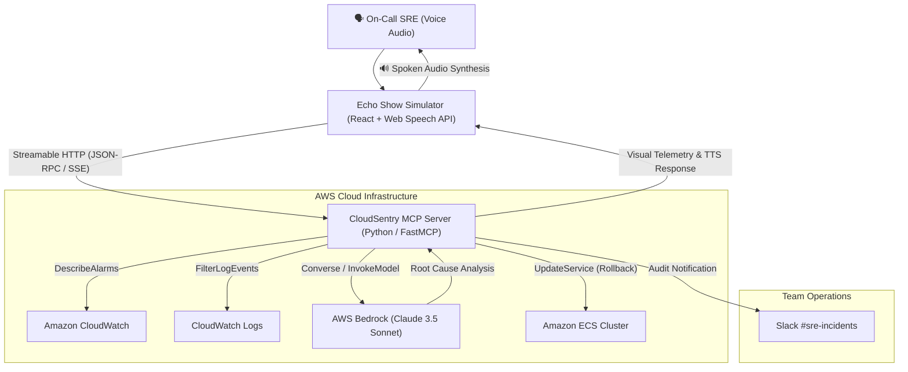

# 🛡️ AWS CloudSentry — The 3 AM Voice Incident Commander

> **Submitted to:** *Build, Ship, Shape: Amazon Developer Hackathon 2026*  
> **Primary Track:** **Alexa+** (Self-Hosted Model Context Protocol Server & Ambient Voice Simulator)  
> **Mini-Challenges Entered:** **AWS Builder** (AWS Bedrock + CloudWatch + ECS) & **Open Source** (MIT License)  
> **Bonus:** Comprehensive Developer Feedback & Friction Log included in [`FRICTION_LOG.md`](./FRICTION_LOG.md) *(Eligible for up to 10% judging bonus)*

---

## 💡 The Problem: The 3:00 AM On-Call Nightmare

It’s 3:15 AM. You are sound asleep. Suddenly, PagerDuty sounds a blaring alarm. 

A high-severity (Sev-2) incident has triggered in production. Under current industry workflows, recovering from this alert is slow, disorienting, and painful:
1. You stumble out of bed to find your laptop in the dark.
2. You authenticate through corporate VPNs, biometric security keys, and MFA tokens.
3. You squint into the blinding AWS Management Console, frantically searching through CloudWatch alarms and scrolling through thousands of unformatted container error logs.
4. **Mean Time to Recovery (MTTR) is 15–20 minutes**—costing companies thousands of dollars per minute in lost customer checkouts.

---

## ⚡ The Solution: AWS CloudSentry on Alexa+

**CloudSentry** transforms Amazon Echo devices into an ambient, autonomous **Voice Incident Commander for Site Reliability Engineers (SREs)**.

Powered by a self-hosted **Model Context Protocol (MCP)** server over **Streamable HTTP** (spec 2025-11-25+) and **AWS Bedrock**, CloudSentry enables an on-call engineer to triage, diagnose, and remediate production outages from their bedside or desk in **under 45 seconds—using only their voice.**

```
                           THE CLOUDSENTRY WORKFLOW
                           
    [ 3:15 AM Alarm ] ──> "Alexa, what's failing in production?"
                                      │
                                      ▼
                      [ CloudWatch Alarms Queried ]
                                      │
                                      ▼
                      [ Stack Traces Ingested ]
                                      │
                                      ▼
                      [ AWS Bedrock Root-Cause Diagnosis ]
                                      │
                                      ▼
    "Rollback checkout-api" ──> [ Voice 2FA Safety Gate ]
                                      │
                                      ▼
    "Confirm rollback"      ──> [ ECS Service Rolled Back ]
                                      │
                                      ▼
                      [ Slack Audit Trail Delivered ]
```

---

## 🏆 Key Features & Technical Highlights

### 1. Multi-Tool Autonomous Agent Chaining (MCP Spec 2025-11-25+)
CloudSentry implements a self-hosted **Model Context Protocol (MCP)** server using the official Python SDK over **Streamable HTTP** (`/mcp`), exposing 5 production tools:
* `get_active_alarms`: Real-time query of AWS CloudWatch alarms in `ALARM` state.
* `fetch_error_logs`: Targeted extraction of trailing stack traces from `/ecs/{service_name}` log groups.
* `diagnose_incident`: Invokes **AWS Bedrock (Claude 3.5 Sonnet)** to correlate log stack traces with recent git commits, detecting resource bottlenecks (e.g., Linux cgroup `OOMKilled` exit code 137).
* `execute_rollback`: Safe, programmatic rollback of Amazon ECS task definitions.
* `post_slack_notification`: Instant audit trail delivery to team incident channels.

### 2. Enterprise Safety: Voice 2FA Confirmation Protocol
The #1 fear of deploying AI agents in cloud infrastructure is hallucinated destructive actions. CloudSentry introduces an enterprise-grade **Voice 2FA Protocol**:
* **Read-only actions** (inspecting alarms, analyzing logs) execute autonomously.
* **Destructive mutations** (service rollbacks, task terminations) trigger an interactive **Safety Gate**. Alexa lights up an **amber warning ring** on the Echo Show, requiring an explicit spoken confirmation phrase (*"Confirm rollback"*) before any AWS API mutation occurs.

### 3. Voice-Native Interaction Model (Echo Show Ambient Screen)
* **The Voice Rule:** Never read 100 lines of logs over audio. Alexa speaks a concise 2-sentence summary (*"Checkout API is failing with 502s due to an OOM crash in deployment v2.4. Bedrock recommends rollback to revision 41"*).
* **The Visual Screen:** The Echo Show ambient smart display renders live CloudWatch metrics (Memory, CPU, 5xx count), the full Bedrock diagnostic breakdown, and the active task definition revision in real time.

### 4. Zero-Cost Triple-Tier Architecture (Live AWS, LocalStack, and Mock)
Judges and developers can run CloudSentry in three distinct operational modes without incurring cloud bills:
1. **Local AWS Emulation ($0.00 Cost):** Run `./run.sh --local-aws` to launch with real CloudWatch Alarms and Log Groups on port 4566. Standard `boto3` makes authentic signed AWS SigV4 HTTP requests at zero cost.
2. **Live AWS Cloud:** Automatically activates when `AWS_ACCESS_KEY_ID` is present, querying production CloudWatch, ECS, and Bedrock.
3. **Zero-Config Mock Engine:** Automatically activates if neither is present, allowing immediate evaluation without Docker or credentials.

### 5. Interactive 3D Amazon Echo Hardware & Hands-Free Alexa Voice
* **Interactive 3D Echo 4th Gen (Three.js):** Features a rendered charcoal acoustic fabric sphere, top tactile buttons, and a dynamic 360° illuminated base light ring that reacts in real time (Cyan Standby/Listening, Blue Thinking spinner, Amber Voice 2FA, Green Resolution). Full orbital mouse/touch drag controls let you inspect the hardware from any angle!
* **Natural Hands-Free Voice Control:** Speak *"Alexa"* naturally—the system plays the authentic dual-tone acoustic chime (G5 $\to$ C6), illuminates the cyan listening beam, and extracts your instruction without awkward wake banners or audio clipping.

---

## 📐 System Architecture



---

## 🚀 Quickstart: Running in Under 2 Minutes

### Prerequisites
* Python 3.10+
* Node.js v18+ and npm

### 1. Clone & Set Up Environment
```bash
git clone https://github.com/YOUR_USERNAME/cloud-sentry.git
cd cloud-sentry
```

### 2. Launch Options

#### Option A: One-Command Launch (Zero-Config Mock Mode)
```bash
chmod +x run.sh
./run.sh
```

#### Option B: Zero-Cost Live AWS Emulation (LocalStack)
To test authentic signed `boto3` requests against local CloudWatch without an AWS bill:
```bash
# 1. Start LocalStack
docker compose up -d

# 2. Seed realistic CloudWatch alarms and container logs
backend/venv/bin/python3 backend/seed_localstack.py

# 3. Launch CloudSentry targeting LocalStack
AWS_ENDPOINT_URL=http://localhost:4566 ./run.sh
```

Or run manually:

#### Terminal 1 — Start the MCP Backend:
```bash
cd backend
source venv/bin/activate  # or python3 -m venv venv && source venv/bin/activate
pip install -r requirements.txt
python3 -m uvicorn server:app --host 0.0.0.0 --port 8000 --reload
```
* MCP Streamable HTTP endpoint: `http://localhost:8000/mcp`
* Agent API: `http://localhost:8000/api/voice-turn`

#### Terminal 2 — Start the Alexa+ Echo Simulator:
```bash
cd frontend
npm install
npm run dev
```
Open **`http://localhost:5173`** in Google Chrome or Microsoft Edge.

---

## 🎬 3-Minute Video Demo Script (How to Test)

1. **Step 1 (The Alarm):** Click the glowing Echo orb (or click **"1. What is failing in prod?"**).
   * *Spoken Query:* `"Alexa, what is failing in production?"`
   * *Alexa Response:* *"ECS service checkout-api in us-east-1 is throwing 502 Bad Gateway errors. CloudWatch shows memory spiked to 99% following deployment v2.4.1. AWS Bedrock recommends rolling back to revision checkout-api:41."*
   * *Visual Display:* CloudWatch telemetry card turns **RED**, displaying 99.4% memory utilization and Bedrock root-cause analysis.
   * *Live MCP HUD:* Shows `get_active_alarms`, `fetch_error_logs`, and `diagnose_incident` executed.

2. **Step 2 (The Remediation Request):** Click the orb or click **"2. Rollback checkout-api"**.
   * *Spoken Query:* `"Rollback checkout-api to revision 41"`
   * *Alexa Response:* *"Rolling back checkout-api will redeploy the cluster to task definition checkout-api:41. Say 'CONFIRM' to authorize this deployment."*
   * *Visual Display:* Echo ring pulses **AMBER**; Voice 2FA authorization banner appears.

3. **Step 3 (Voice 2FA Execution):** Click the orb or click **"3. Confirm rollback"**.
   * *Spoken Query:* `"Confirm rollback"`
   * *Alexa Response:* *"Rollback confirmed. Service checkout-api has been rolled back to task definition checkout-api:41. Health checks are passing, and I have notified the incident channel."*
   * *Visual Display:* Echo ring pulses **GREEN**; status badge updates to **RESOLVED**; memory drops to 41.2%; Slack audit notification is dispatched.

---

## 👥 Hackathon Details & Collaborator Access

* **Hackathon:** Build, Ship, Shape: Amazon Developer Hackathon 2026
* **Track:** Alexa+
* **Mini-Challenges:** AWS Builder + Open Source
* **License:** [MIT License](./LICENSE)
* **Amazon Developer Relations Reviewers:**
  * `chris-trag`
  * `knmeiss` (Kourtney Meiss)
  * `giolaq` (Giovanni Laquidara)
  * `anishamalde` (Anisha Malde)
  * `mosesroth` (Moses Roth)
  * `emersonsklar` (Emerson Sklar)

